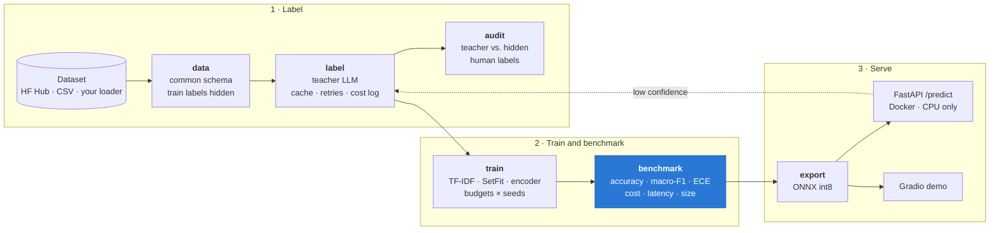

# Heartcut

[](https://github.com/Amir-Parsian/Heartcut/actions/workflows/ci.yml)
[](https://pypi.org/project/heartcut/)
[](LICENSE)


**Replace an expensive LLM classifier with a tiny model that keeps most of its accuracy
at a fraction of the cost and latency.** Heartcut labels your data with a teacher LLM,
trains compact students on those labels, benchmarks teacher and students on the same
human-labeled test set, and serves the winner on a CPU.

Most teams now call an LLM API for simple, high-volume tasks such as ticket routing or
intent tagging. Heartcut is a repeatable way to measure, and then cut, that bill.

The name comes from distilling: the *heart cut* is the clean middle of the run that the
distiller keeps. Heartcut keeps the part of the LLM your task needs and leaves the
expensive rest behind.

## Results

<!-- results:start -->

No benchmark results yet. This block is written by `heartcut report` from
`results/<experiment>/results.json`, and only from that file, so the README can never
show a number the benchmark did not produce. Simulated-teacher runs are refused.

<!-- results:end -->

## How it works



The benchmark is the core deliverable; the serving stack exists to prove that the
student's cost and latency numbers hold outside a notebook.

| Stage | Command | What it does |
|---|---|---|
| Data | `heartcut data` | Loads Banking77 / CLINC150 (or your task) into `id, text, label`; deterministic splits; moves train/validation labels to a hidden table. |
| Label | `heartcut label` | Sends the unlabeled pool (and the test split, to score the teacher) to the teacher. Async, rate-limited, retried, cached by prompt hash, budget-capped; logs tokens and dollars per call. `--dry-run` estimates the cost first; `--offline` guarantees zero spend. |
| Audit | `heartcut audit` | Teacher labels vs. the hidden human labels: accuracy, per-class errors, top confusions, agreement vs. correctness, effect of the confidence filter. |
| Train | `heartcut train` | Three student tiers × labeling budgets × seeds, on teacher labels only, logged to MLflow. Hard or soft (distillation) labels. |
| Benchmark | `heartcut benchmark` | Everything on the human-labeled test set: one table, a Pareto chart, a learning curve, error analysis, routing analysis, model card. |
| Export | `heartcut export` | Best student (chosen on teacher-labeled validation data) to ONNX with dynamic int8 quantisation, parity-checked against the original. |
| Serve | `heartcut serve` | FastAPI on CPU, optional fallback to the teacher below a confidence threshold. |

## Install

Requires Python 3.11+.

```bash
pip install "heartcut[all]"     # every stage, including PyTorch for the neural students
pip install "heartcut[serve]"   # only serve an exported student: ONNX Runtime, no PyTorch
```

The extras (`pipeline`, `teachers`, `students`, `export`, `serve`, `tracking`, `demo`)
can be combined; [pyproject.toml](pyproject.toml) lists what each one installs. The
ready-made experiment configs and prompts live in this repository, so the quickstart
below runs from a clone.

## Quickstart

Requires [uv](https://docs.astral.sh/uv/).

```bash
git clone https://github.com/Amir-Parsian/Heartcut && cd Heartcut
uv sync --all-extras

# 1. Free smoke run: the whole pipeline on a Banking77 slice with the simulated teacher.
make smoke

# 2. Reproduce the published benchmark from cached teacher labels (no API spend).
make labels-pull LABELS_REPO=<user>/heartcut-banking77-labels
make benchmark && make report

# 3. Or label with a real teacher yourself.
export ANTHROPIC_API_KEY=...                  # keys come from the environment only
make label-dry-run                            # cost estimate, no calls
make label && make audit && make benchmark
```

Any config value can be changed from the command line, e.g. a cheaper teacher and a
200-example development slice:

```bash
uv run heartcut label -c configs/experiments/banking77.yaml \
    --set teacher=configs/teachers/claude-haiku-5-5.yaml \
    --set dataset.max_examples.train=200
```

## What is compared

| Tier | Model | Size | Notes |
|---|---|---|---|
| Teacher | Claude via the Anthropic API, or an open-weights model behind an OpenAI-compatible server (vLLM, Ollama) | hosted / 7B | JSON-schema-constrained answers; optional self-consistency voting |
| Baseline | TF-IDF word + char n-grams, logistic regression | a few MB | sub-millisecond on CPU |
| Small | SetFit-style: contrastive fine-tuning of `all-MiniLM-L6-v2` + logistic-regression head | 22M params | |
| Medium | `distilbert-base-uncased` fine-tuned end to end | 66M params | ModernBERT config included |

Datasets: **Banking77** (13,083 banking queries, 77 intents) is the primary benchmark;
**CLINC150** (150 intents plus out-of-scope) is the second. The official test split with
its human labels is the only ground truth for final scores. Training labels are hidden
from training and used once, by the audit, to measure teacher label quality.

### Benchmark rules

- Every model is scored on the same human-labeled test set, on the same machine.
- Students: mean and standard deviation over 3 seeds. The *served* row is the exported
  artifact (ONNX int8 for transformer students) of the seed with the best agreement with
  the teacher on teacher-labeled validation data. The test set never chooses anything.
- Cost per 1,000 predictions. Teacher: logged API tokens × published price (prompt-cache
  reads and writes included). Student: CPU instance hourly price ÷ measured throughput.
- Latency: single request p50/p95 after warm-up; throughput: batched, same CPU.
- `results.json` records the hardware, library versions, git revision and the date of
  every price used. See [docs/benchmark.md](docs/benchmark.md).

## Serving

```bash
uv run heartcut export -c configs/experiments/banking77.yaml   # prints the export dir
docker build --build-arg MODEL_DIR=<export dir> -t heartcut-serve .
docker run --rm -p 8000:8000 heartcut-serve

curl -s localhost:8000/predict -H 'content-type: application/json' \
     -d '{"text": "My card still has not arrived"}'
# {"label": "card_arrival", "confidence": <float>, "latency_ms": <float>, "source": "student", ...}
```

`POST /predict` also takes `{"texts": [...]}` (up to 256). `GET /health` reports the
model and router settings. The image contains no PyTorch: just ONNX Runtime,
`tokenizers` and FastAPI. Set `HEARTCUT_FALLBACK_THRESHOLD` and
`HEARTCUT_TEACHER_CONFIG` (build with `--build-arg EXTRAS=serve,teachers`) to send
low-confidence predictions to the teacher; the benchmark's routing table shows what
share of traffic that would be and the blended cost.

The [Gradio demo](demo/) shows student and teacher side by side with latency and cost
per call, and deploys to Hugging Face Spaces.

## Add your own task

For a complete runnable example, see [helpdesk distillation](examples/helpdesk/README.md):
teacher labeling, hard/soft student training, benchmarking, export, fresh predictions
and HTTP serving, with a free simulated run and instructions for real teachers.

```bash
uv run --extra pipeline python examples/helpdesk/demo.py
```

A new dataset needs a config file and, if none of the built-in loaders fit, a loader
function. No core code changes. See [docs/adding-a-task.md](docs/adding-a-task.md) and
the worked example in [examples/helpdesk](examples/helpdesk).

## Project layout

```
src/heartcut/
├── data/        loaders, common schema, deterministic splits, hidden labels
├── teachers/    prompts, Anthropic + OpenAI-compatible backends, cache, runner, pricing
├── students/    TF-IDF, SetFit-style, encoder fine-tune, training stage
├── eval/        metrics, label audit, cost model, latency bench, charts, report
├── serve/       ONNX export, CPU runtime, FastAPI app, fallback router
└── cli.py       Typer CLI, one command per stage
configs/         datasets, teachers, students, experiments, published prices
prompts/         prompt templates
demo/            Gradio app (Hugging Face Spaces)
examples/        a custom task end to end
results/         benchmark tables and charts (committed)
docs/            design notes, methodology, guides, blog post draft
```

## Development

```bash
make install     # all extras + pre-commit hooks
make lint typecheck test
```

CI runs ruff, strict mypy and the tests (coverage gate: 80% of `src/`) on Python 3.11
and 3.12, then builds the Docker image and calls `/predict` on it. CI never calls a paid
API: teacher tests use mocked HTTP transports and a simulated teacher. Design decisions
and their trade-offs are in [docs/design.md](docs/design.md).

## Status

v0.1.0 is on PyPI with the full pipeline, tests and CI. Definition of done for v1.0.0:

- [ ] `make benchmark` reproduces every reported number from cached labels on a clean
      machine (implemented; needs the first real labeling run and published labels)
- [ ] Best student within 3 accuracy points of the teacher on Banking77 test, or the
      README explains the gap (needs results)
- [ ] Student p95 under 50 ms per request on a standard 4-core CPU (needs results)
- [x] Docker image builds and serves `/predict` in CI
- [x] CI green with 80%+ coverage on `src/` (about 96%)
- [x] `pip install heartcut` from PyPI; a version tag publishes the release and its
      GitHub release notes
- [ ] Live demo link, results table and Pareto chart in this README (needs results and a
      deployed Space)
- [x] Adding a new dataset needs only a config and a loader, shown in a guide

## License and data

Code: [MIT](LICENSE). Banking77 is released by PolyAI under CC BY 4.0; CLINC150 by
Clinc under CC BY 3.0. Teacher labels published by this project keep the source texts'
licenses; confirm redistribution terms before making a labels dataset public.
